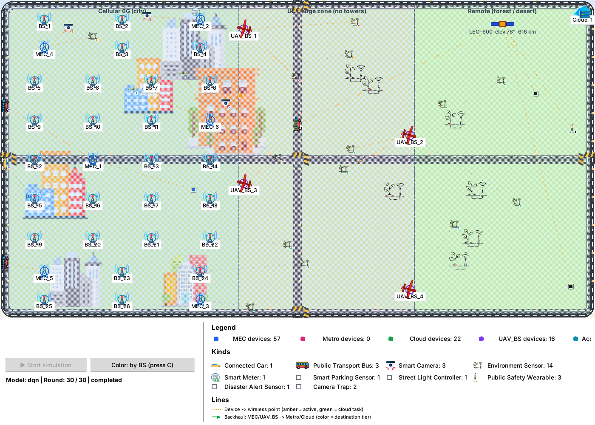

# 6G-UrbanNetSim

6G-UrbanNetSim is a Python research simulator for task offloading and resource allocation across terrestrial, UAV-assisted, and satellite-enabled IoT networks. It lets researchers vary coverage, mobility, workloads, link conditions, and compute capacity, then compare how scheduling policies affect service delivery, device battery use, and infrastructure load.



## What it simulates

| Coverage zone | Modeled infrastructure and execution paths |
| --- | --- |
| Cellular | 6G FR3 base stations, local and collaborative mobile edge computing (MEC), metro edge, and cloud. Devices can also use a UAV edge when one is reachable. |
| UAV edge | Patrolling UAV base stations with onboard compute. Devices can execute locally, offload over a viable UAV link, or reach the cloud through the satellite path. |
| Remote | Local execution or cloud access through a low Earth orbit (LEO) satellite and a ground gateway. |

The default deployment is a zoned 10 × 10 km scenario. The simulator updates device mobility, radio association, and handovers over successive rounds. Offloaded tasks are evaluated along their network path, including modeled packetization, link queues, delivery and retransmission behavior, and compute admission. The satellite model derives slant range from a periodic elevation profile and uses a transparent payload. The satellite action routes through the ground gateway to cloud compute. The [satellite extension guide](docs/SATELLITE_IOT_EXTENSION.md) covers the access links and model assumptions.

Device profiles include urban mobile entities and environmental IoT workloads such as low-power sensors, disaster-alert devices, and camera traps. The scheduler can compare Random, Q-learning, DQN, Double DQN, PPO, and A2C through a shared execution interface. The current learning configuration exposes all seven actions to the policy. Physical availability is represented in the state, and an infeasible selection is recorded as a failed attempt. Service-specific rewards favor low latency for URLLC-like alerts, low device energy for mMTC sensing, and compute headroom for eMBB imagery. See the [learning guide](docs/UNMASKED_LEARNING.md) for the reward and checkpoint schema.

## How an experiment runs

1. **Build the scenario.** The launcher loads the deployment, workload, and policy settings. The simulator places access points and compute servers, creates the device population, and initializes the network and output directories.
2. **Update coverage and workload.** Each round advances mobility and refreshes the serving access point or satellite path. Active devices generate tasks using profiles that define workload size, compute demand, and deadline.
3. **Select and attempt an action.** The policy sees task, coverage, and per-tier observations. Its seven choices are local execution, MEC, collaborative MEC, metro edge, direct cloud, UAV edge, and satellite-routed cloud. The executor checks the actual route and capacity for the selected choice.
4. **Record the outcome.** The simulator accounts for delivery, completion time, resource usage, device energy, and battery state. During training, the measured outcome also produces the transition and service-specific reward used to update the policy.

The simulator distinguishes a packet reaching its next hop, an application task completing, and a task completing before its deadline. When comparing policies, use the same deployment and workload settings, record the seeds, and report outcomes by coverage zone and service class. This keeps high aggregate success from obscuring failures among remote devices or time-critical alerts.

## Quick start

From the repository root, use a Python 3 environment with Tkinter available. The launcher imports Tkinter even in headless mode. On Linux, install your distribution's Tkinter package if Python cannot import it.

```bash
python -m pip install -r requirements.txt
```

For a short run that starts without trained policies, set these values in [`config/run.py`](config/run.py):

```python
RUN_TRAINING = False
COMPARISON_ENABLED = False
MAIN_SCHEDULER = "random"
WORKLOAD_PROFILE = "custom"
ROUNDS = 3
MAX_DEVICES = 10
MULTISEED = False
TRAINING_GUI = False
EVALUATION_GUI = False
```

Then launch from the repository root:

```bash
python -m applications.MainApplication
```

Run outputs are written under `output/`. To train a policy, set `RUN_TRAINING = True` and select a learned scheduler such as `dqn`. Use the same policy and compatible configuration for evaluation with `RUN_TRAINING = False`. Evaluation of learned policies requires matching checkpoints in `trained_model/unmasked-service-objectives-v1/`. The original run configuration selects multi-model evaluation, so use the short-run settings above or train the required policies first.

## Configure and analyze experiments

| Location | What it controls |
| --- | --- |
| [`config/run.py`](config/run.py) | Model selection, training or evaluation, rounds, device counts, seeds, and GUI settings |
| [`config/simulation.py`](config/simulation.py) and [`config/zones.py`](config/zones.py) | Deployment profile, zone layout, satellite geometry, and device mix by zone |
| [`config/`](config/) | Radio profiles, topology, mobility, workloads, rewards, energy, and evaluation plans |
| [`core/`](core/) and [`network/`](network/) | Simulation lifecycle, deployment, resource admission, packet execution, and routing |
| [`scheduler/`](scheduler/) | Policy implementations, state and action definitions, and model comparison |
| [`metrics/`](metrics/), [`live/`](live/), [`visualization/`](visualization/), and [`tools/`](tools/) | Metrics, live maps, plots, and experiment analysis |

Use the per-model CSVs to examine selected actions, completion and deadline outcomes, latency, utilization, energy, and battery state. The zoned scenario also records coverage and satellite geometry fields. For multi-seed experiments, the analysis tools can aggregate seed-level outcomes. The [packet execution guide](docs/PACKET_EXECUTION_GUIDE.md) explains how the packet path and its metrics are modeled.

## Related research

Afzal Badshah et al., *Deep Reinforcement Learning for Sustainable and Reliable Resource Allocation in Satellite-Enabled Environmental IoT Networks* (companion manuscript). The study uses 6G-UrbanNetSim to compare service-aware offloading for environmental sensing, critical alerts, and high-volume imagery. The simulator also supports experiments with alternative deployment profiles, workload mixes, mobility settings, and scheduling policies.
